<p align="center">
  
</p>

# Modbus RTU ↔ IP (TCP/UDP) Gateway for ESPHome

[](LICENSE)

A Wi-Fi Modbus gateway built with **ESPHome**, **ESP32-S3** and the **Arduino framework**. It bridges a serial Modbus RTU / RS-485 bus and a Modbus IP (TCP/UDP) network, with a bilingual web interface for configuration and frame diagnostics.

> **Reference hardware:** [Waveshare ESP32-S3-RS485-CAN](https://docs.waveshare.com/ESP32-S3-RS485-CAN). The project defaults match this board's RS-485 signals: TX GPIO17, RX GPIO18 and RS485 enable GPIO21. The project maintainer reports successful testing with this device, including four connected Modbus TCP clients.

> **Version 1.3.2 source on `main`:** supports **TCP Client, TCP Server, UDP Client and UDP Server**. The maintainer reports successful functional tests of the four modes; robustness testing remains pending. See [TCP/UDP development and UI behavior](docs/TCP_UDP_DEVELOPMENT.md).

### TCP/UDP web UI (v1.3.2)

The source interface labels the network section **Modbus IP**, offers a TCP/UDP selector, and includes four harmonized blue/cyan section thumbnails matching the RTU ↔ IP header artwork. The IP thumbnail explicitly shows **TCP / UDP**. The **Persistent TCP connection** control is displayed only for **TCP Client**; it is hidden for TCP Server and both UDP modes, and the stored TCP setting is preserved while UDP is selected.

## Transport and operating modes (v1.2.7)

**Important — transport compatibility:** The Modbus IP client and its corresponding Modbus IP server **must use the same transport protocol**: **TCP Client ↔ TCP Server**, or **UDP Client ↔ UDP Server**. A TCP client cannot communicate directly with a UDP server, nor can a UDP client communicate directly with a TCP server. Using the same port number (for example, 502) does not make the two transports interchangeable.


| Transport | Client mode: RTU → IP | Server mode: IP → RTU |
|---|---|---|
| **TCP** | RTU requests forwarded over a TCP connection to the remote Modbus server | Accepts Modbus TCP requests (up to four simultaneous TCP connections) and forwards them to RS-485 |
| **UDP** | RTU requests sent as MBAP datagrams to the configured IPv4 endpoint; responses are matched to the request | Receives MBAP datagrams, queries the RS-485 bus and replies to the originating IP/port |

Choose **Transport: TCP / UDP** and **Mode: Client / Server** in Section 1 **Modbus IP**. TCP connection persistence is offered **only in TCP Client**. Client and Server read-cache switches work with either transport; the shared cache TTL mode selector is shown only when the selected mode's cache is enabled. UDP has no connection persistence and no delivery guarantee. See [Quick start](docs/QUICK_START.md), [Protocol](docs/PROTOCOL.md) and [TCP/UDP behavior](docs/TCP_UDP_DEVELOPMENT.md).

## Response cache

The gateway provides two independent optional response caches, one for each **Client/Server direction**, shared across the selected TCP or UDP transport:

- **IP Client mode (RTU → TCP/UDP):** repeated RTU read requests can be answered from the last valid Modbus TCP response.
- **IP Server mode (TCP/UDP → RTU):** repeated TCP read requests can be answered from the last valid RTU response without querying the RS-485 bus again.

Both caches are disabled by default. Each can be enabled separately in the Web UI. Choose **Fixed TTL** (50–10,000 ms; default 500 ms) or **Adaptive TTL**, which estimates a separate TTL for each polling request key from 80% of its observed request interval (bounded to 50–10,000 ms). The fixed value is used until an interval is observed. The mode is persisted in NVS; adaptive estimates remain in RAM. The conventional cache has been exercised in user-provided gateway logs. The optional background refresh added in source v1.3.2 is a separate feature and still needs ESPHome build and hardware validation. The cache has 64 entries and only stores valid read functions 01–04. Write and read/write operations are never cached; successful writes invalidate only overlapping cached ranges in the corresponding writable data space. Unknown or malformed write ranges trigger a conservative invalidation of all cached reads for that Unit ID and direction. Cache hits do not extend the TTL. Cached values may therefore be stale up to the applicable fixed or adaptive TTL; keep the cache disabled when every read must return the freshest device value.

See [Cache behavior and configuration](docs/CACHE.md) for details. The cache option displayed in Section 1 follows the selected Client/Server mode; the other mode's setting remains saved in NVS.

### Bounded background refresh for RTU display (source v1.3.2)

An opt-in **stale-while-revalidate** option is available in TCP Client mode
when the client read cache and persistent TCP connection are enabled.
Validated cached reads can answer the RTU display immediately even after
their normal TTL expires, up to a configurable **maximum data age**.
A separate background Modbus TCP transaction refreshes the cache and **never
sends a second RTU response** to an already-serviced request. RTU responses
from slow foreground TCP transactions are dropped if they cannot finish
before the configurable master reply deadline.

Default behavior is unchanged; the feature is initially **off**. Configure
it in the Modbus IP section. Defaults are 10,000 ms maximum data age and
500 ms RTU reply window; the TTL can still be fixed or adaptive.
A cached response remains *structurally validated*, but its actual device
values can be stale—do not use this mode for signals that must always
reflect live safety-critical state.

The `/cache-stats` endpoint reports stale hits, successful/failed refreshes,
and dropped late RTU responses. Full details in [Cache behavior](docs/CACHE.md).
**ESPHome compilation and hardware tests are still required** for this source
revision.

## Features

- **Live cache diagnostics (current `main`):** the Counters / Diagnostics panel displays active valid cache entries (`0 / 64` when disabled) and the effective TTL range for populated entries, updated with the frame diagnostics. The occupancy reflects the selected Client/Server direction; expired entries are excluded. The cache occupancy is derived from RAM entries and was not independently bench-calibrated.

- Per-transaction latency diagnostics in both TCP Client and TCP Server modes.
- Non-blocking TCP response reception in normal TCP Client mode: the ESPHome loop keeps servicing the Web UI and other tasks while the remote Modbus TCP server prepares its response.

- **Four transport/mode combinations** (TCP Client, TCP Server, UDP Client, UDP Server); the TCP-specific details below describe the TCP variants:
  - **TCP Client / RTU Slave:** an external RTU master polls the ESP32; the gateway forwards each request to a configured remote Modbus TCP server.
  - **TCP Server / RTU Master:** Modbus TCP masters connect to the ESP32; the gateway forwards their requests to downstream RTU slave devices.
- **Up to four concurrent TCP master connections** in TCP Server mode.
- **Single-transaction RS-485 scheduling:** the half-duplex RTU bus is accessed one transaction at a time; ready requests from connected clients are serviced with a rotating starting slot.
- TCP Transaction ID and the incoming TCP Unit ID are preserved in the response.
- **RTU address / Unit ID handling** is explicit and configurable (see [Protocol behaviour](docs/PROTOCOL.md)).
- Web interface in **French and English**.
- Settings are saved persistently in ESP32 NVS (Arduino `Preferences`). GPIO changes trigger an automatic restart so the UART can be reinitialized.
- Frame diagnostics: live RTU/TCP frame log, RTU CRC status, manual RTU-frame test and text export of the latest 64 log entries, including timing diagnostics.
- **RTU CRC protection:** invalid RTU requests/responses are rejected before forwarding or caching; CRC failures are recorded in the diagnostics log. TCP Server mode returns gateway exception `0x0B` for an invalid downstream RTU response.
- **Selectable error policy:** one bilingual Web UI setting applies to Client and Server (TCP/UDP). `Standard` (default) returns a Modbus exception for communication/protocol errors; `Silent` sends no Modbus response for any error, including a received slave exception. RTU frames with incorrect CRC are never forwarded or cached; in Standard mode only a newly generated gateway exception may be sent. The setting survives restart.
- **Mode-aware cache controls:** Section 1 shows only the cache switch for the selected TCP mode. The inactive mode's enable setting is preserved when saving or switching modes.
- Images are served on separate HTTP routes instead of being embedded in the HTML response, keeping the page response small.
- **Persistent TCP Client connection** is enabled by default to avoid a new TCP handshake for every RTU request; disable it in Section 1 when a remote server requires one connection per request. The gateway reconnects when it detects a dropped session.
- **Web UI reboot button** displays a five-second countdown and returns to the main page as soon as the gateway is online again.
- TCP diagnostics report the actual IP address from ESPHome's Wi-Fi component, rather than relying only on the Arduino `WiFi.localIP()` accessor.

## System architecture


### Persistent TCP reconnect (source v1.2.8)

In **TCP Client** mode with **Persistent TCP connection** enabled, if a reused socket fails while sending a request, disconnects before a complete response, or times out waiting for a response, the gateway closes that socket and retries **one time** with a new TCP connection for Modbus function **03** or **04** only. The log shows `TCP RETRY`. Writes are **never automatically replayed**, to avoid duplicate side effects. Reconnection is request-driven, not a background keepalive. This behavior is present on `main`. See the v1.3.2 validation notes above for the newer background-refresh option.

## Historical web interface screenshots (v1.2.7)

These screenshots document the v1.2.7 interface, not all the controls of the current v1.3.2 source (such as background cache refresh).

### Captures réelles de l'interface Web v1.2.7 — quatre modes

Ces **16 captures réelles** proviennent de l'interface ESP32-S3 en version **1.2.7**, et remplacent les anciennes captures v1.2.6 et les simulations SVG. Les valeurs (IP, états, trames, compteurs) sont des exemples observés, pas des résultats de validation exhaustive. Les modes **Client / Serveur** sont indépendants du transport **TCP / UDP**.

#### TCP Client — RTU vers serveur TCP

Connexion TCP persistante optionnelle, cache Client et TTL adaptatif, connexions et journal des erreurs TCP.

**1. Configuration Modbus IP et bandeau**

<a href="docs/assets/v1.2.7-tcp-client-01.png">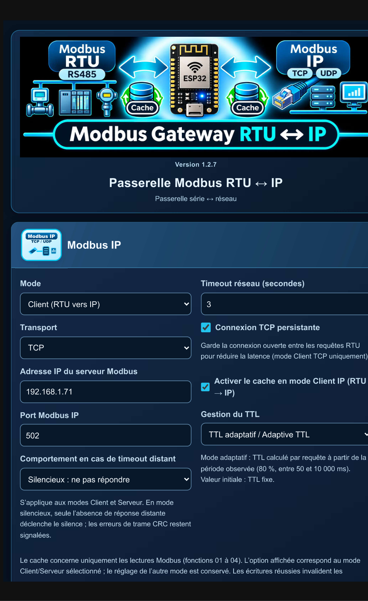</a>

**2. Paramètres RTU, GPIO et état des connexions**

<a href="docs/assets/v1.2.7-tcp-client-02.png">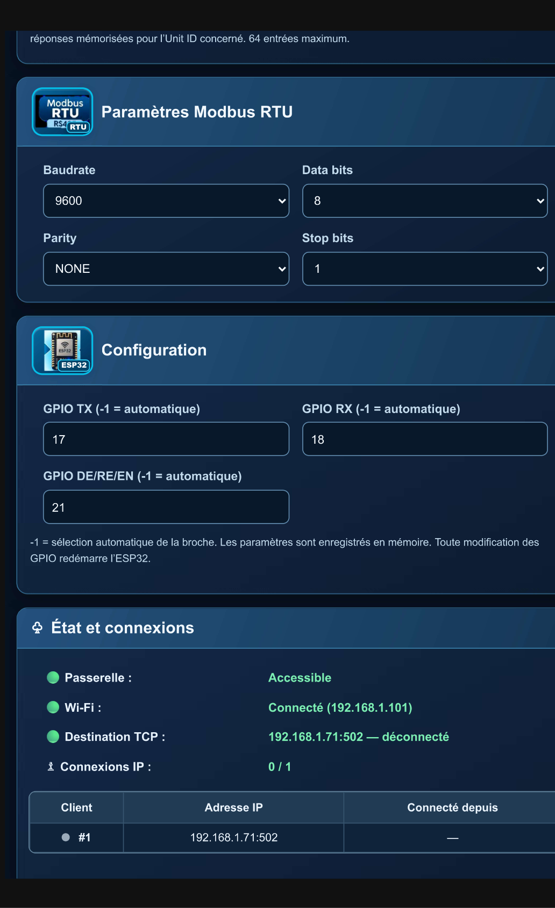</a>

**3. Compteurs / Diagnostics et envoi manuel**

<a href="docs/assets/v1.2.7-tcp-client-03.png">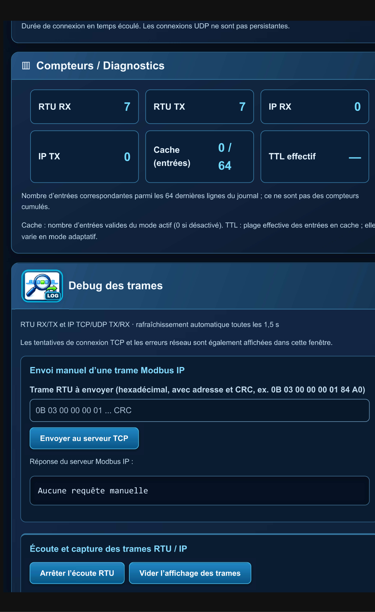</a>

**4. Écoute des trames, journal et commandes**

<a href="docs/assets/v1.2.7-tcp-client-04.png">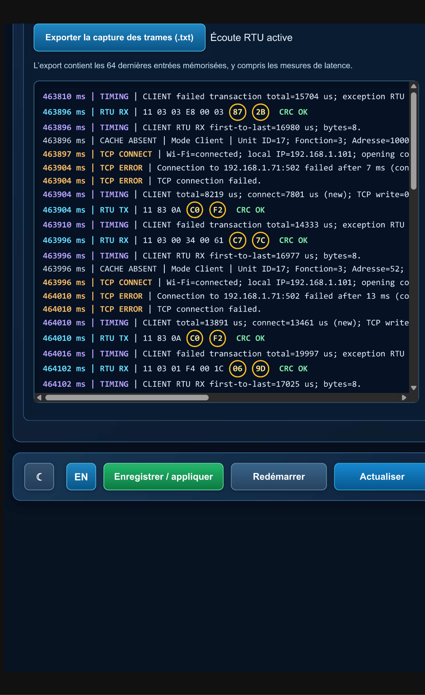</a>

#### TCP Serveur — clients TCP vers RTU

Port d'écoute 502, clients TCP (jusqu'à quatre affichés), paramètres RTU et diagnostics.

**1. Configuration Modbus IP et bandeau**

<a href="docs/assets/v1.2.7-tcp-serveur-01.png">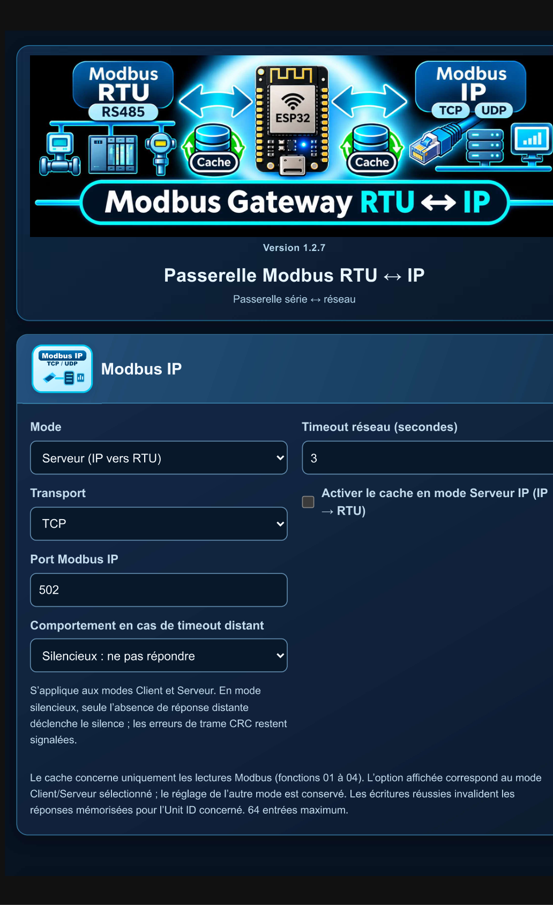</a>

**2. Paramètres RTU, GPIO et état des connexions**

<a href="docs/assets/v1.2.7-tcp-serveur-02.png">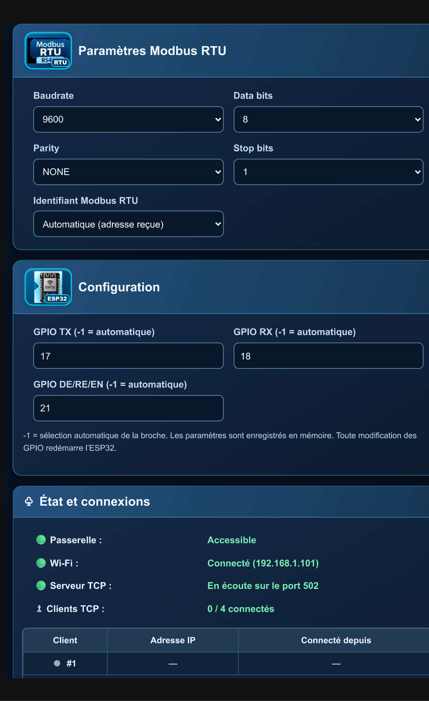</a>

**3. Compteurs / Diagnostics et envoi manuel**

<a href="docs/assets/v1.2.7-tcp-serveur-03.png">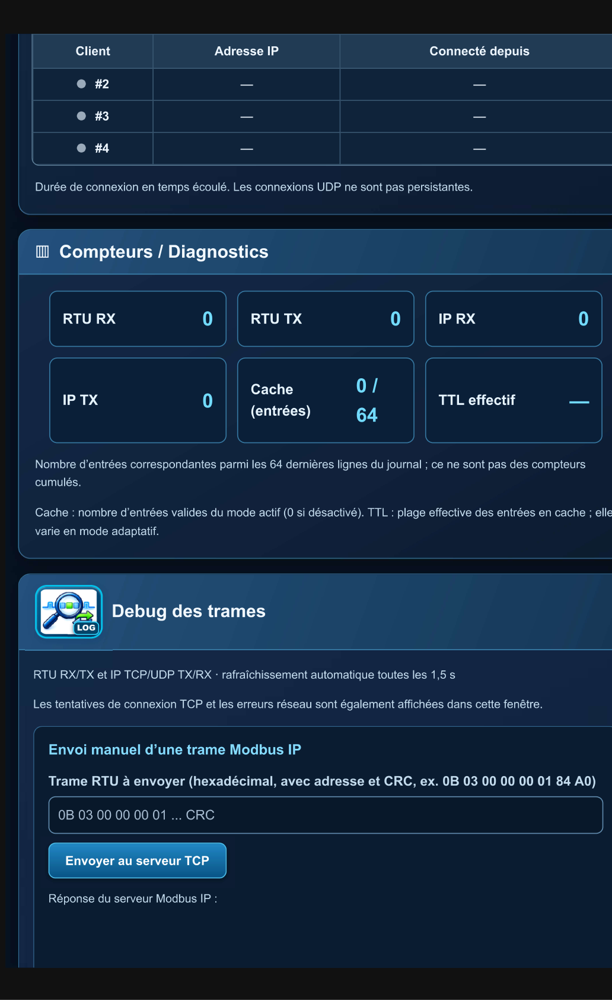</a>

**4. Écoute des trames, journal et commandes**

<a href="docs/assets/v1.2.7-tcp-serveur-04.png">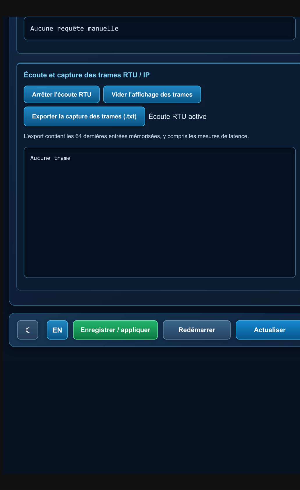</a>

#### UDP Client — RTU vers serveur UDP

Destination UDP, cache Client adaptatif, compteur IP TX et journal des timeouts UDP.

**1. Configuration Modbus IP et bandeau**

<a href="docs/assets/v1.2.7-udp-client-01.png">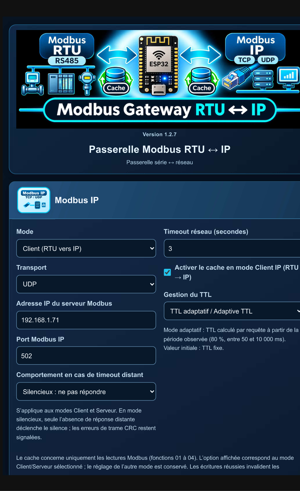</a>

**2. Paramètres RTU, GPIO et état des connexions**

<a href="docs/assets/v1.2.7-udp-client-02.png">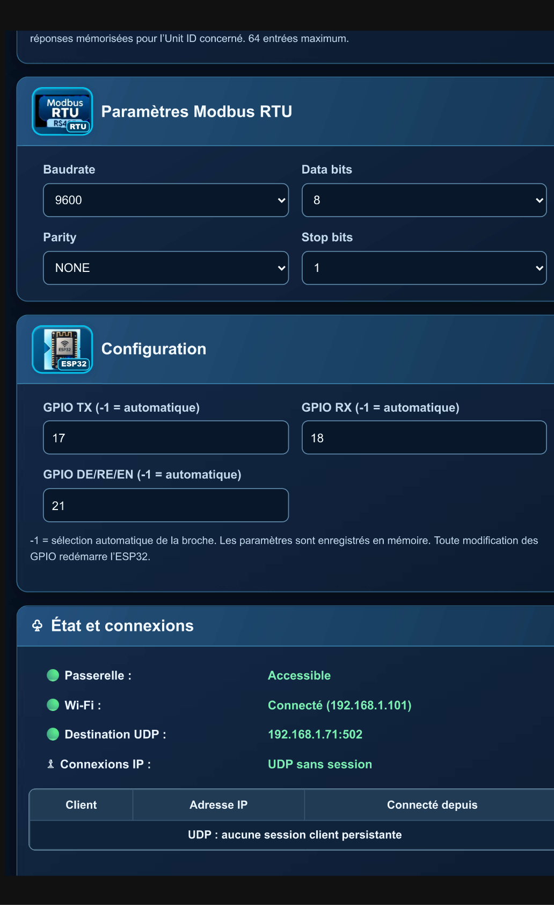</a>

**3. Compteurs / Diagnostics et envoi manuel**

<a href="docs/assets/v1.2.7-udp-client-03.png"></a>

**4. Écoute des trames, journal et commandes**

<a href="docs/assets/v1.2.7-udp-client-04.png">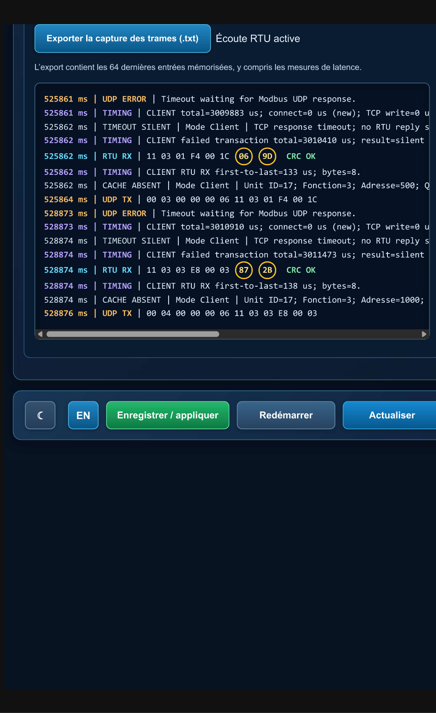</a>

#### UDP Serveur — requêtes UDP vers RTU

Port UDP local 502, absence de session persistante, configuration RTU et journal de capture.

**1. Configuration Modbus IP et bandeau**

<a href="docs/assets/v1.2.7-udp-serveur-01.png"></a>

**2. Paramètres RTU, GPIO et état des connexions**

<a href="docs/assets/v1.2.7-udp-serveur-02.png">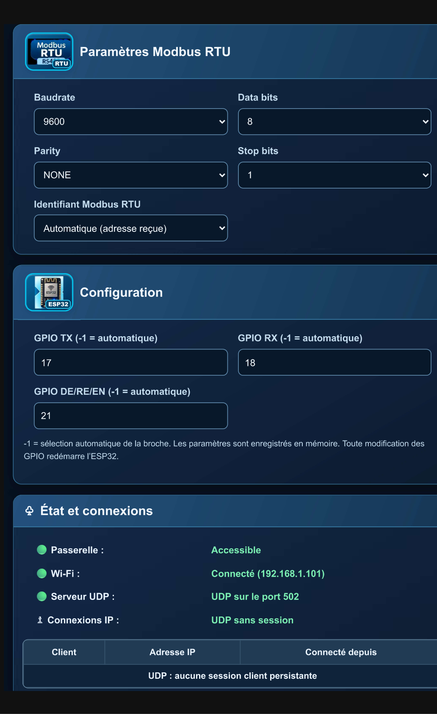</a>

**3. Compteurs / Diagnostics et envoi manuel**

<a href="docs/assets/v1.2.7-udp-serveur-03.png">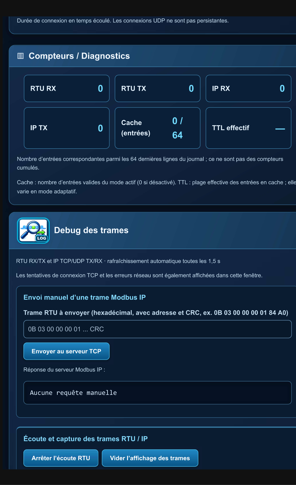</a>

**4. Écoute des trames, journal et commandes**

<a href="docs/assets/v1.2.7-udp-serveur-04.png">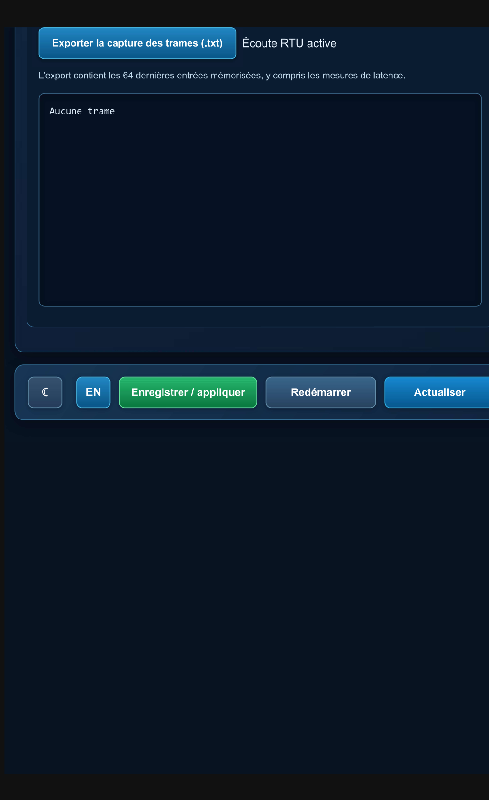</a>

**Remarque :** sur certaines captures UDP, le bouton d'envoi manuel indique encore « Envoyer au serveur TCP » et les descriptions du journal mentionnent TCP. Ces libellés sont ceux de l'interface photographiée et seront à corriger séparément dans le firmware.

## Hardware

The reference board is the **Waveshare ESP32-S3-RS485-CAN**. It provides an isolated RS-485 transceiver, an A+/B− screw terminal, Wi-Fi and USB-C. The board also has a separate CAN interface; CAN is not used by this gateway.

| Gateway signal | ESP32-S3 GPIO | Waveshare signal |
|---|---:|---|
| UART TX | 17 | RS-485 TXD1 |
| UART RX | 18 | RS-485 RXD1 |
| RS-485 direction enable | 21 | RS485_EN |

The mapping is shown in the [Waveshare board schematic](https://files.waveshare.com/wiki/ESP32-S3-RS485-CAN/ESP32-S3-RS485-CAN-Schematic.pdf) and the corresponding defaults are set in `components/modbus_gateway/__init__.py` and the web UI. The web UI allows these GPIO values to be changed for other ESP32-S3 hardware.


Connect the external RS-485 trunk to the board's **A+** and **B−** terminals. The on-board 120 Ω termination is disabled by default; enable it only when this device is at a physical end of the RS-485 line and the bus design calls for termination. See [Hardware and wiring](docs/HARDWARE_WAVESHARE.md) before powering or wiring the device.

## Quick start

1. Install ESPHome on your development computer or use the ESPHome Dashboard.
2. Copy this repository to your ESPHome configuration area.
3. Create a local `secrets.yaml` next to `my-modbus-gateway.yaml` (do not commit it). It must define `wifi_ssid`, `wifi_password` and `api_key`; see [`secrets.yaml.example`](secrets.yaml.example).
4. Review `my-modbus-gateway.yaml`. It targets `esp32-s3-devkitc1-n16r8` and uses the Arduino framework. Adjust the board target only if your exact module variant requires it.
5. Compile and upload:

   ```bash
   esphome compile my-modbus-gateway.yaml
   esphome upload my-modbus-gateway.yaml
   ```

6. Find the ESP32's IP address in your router or ESPHome logs and open `http://<ESP32-IP>/` in a browser on the same network.
7. Configure the TCP/UDP transport and Client/Server mode, network endpoint and serial settings. Press **Save / apply**. The settings are persisted; changing a GPIO restarts the ESP32 automatically.

See [Quick start and configuration](docs/QUICK_START.md) for full instructions.

## Default configuration

| Setting | Initial value |
|---|---|
| Framework | Arduino |
| ESPHome board target | `esp32-s3-devkitc1-n16r8` |
| Initial mode | TCP Client |
| TCP remote host (TCP Client mode) | 192.168.1.100 |
| TCP port | 502 |
| TCP timeout | 3 seconds |
| Remote timeout behavior | Standard (send gateway exception) |
| Persistent TCP Client connection | Enabled by default (configurable in the web UI) |
| RTU serial format | 9600 baud, 8 data bits, no parity, 1 stop bit (8N1) |
| UART TX / RX | GPIO17 / GPIO18 |
| RS-485 direction enable | GPIO21 |
| Concurrent inbound TCP clients | 4 maximum |
| Web interface | HTTP port 80 |

## Address mapping at a glance

| Mode | Data direction | RTU device address behaviour |
|---|---|---|
| TCP Client | RTU → TCP | The RTU request address is forwarded unchanged as the TCP Unit ID. The manual RTU ID setting does not override it. |
| TCP Server — Automatic ID | TCP → RTU | The incoming TCP Unit ID becomes the RTU slave address. |
| TCP Server — Manual ID | TCP → RTU | The configured RTU ID (1–247) is used on RS-485; the TCP response still carries the original incoming Unit ID. |

TCP Server accepts inbound Modbus TCP masters; UDP Server accepts MBAP datagrams from UDP clients. Up to four clients can keep their TCP sessions open at once. Their requests are not executed in parallel on RS-485: one complete RTU transaction is processed at a time.

## Documentation

- [Quick start and configuration](docs/QUICK_START.md)
- [System architecture](docs/ARCHITECTURE.md)
- [Waveshare ESP32-S3-RS485-CAN hardware and wiring](docs/HARDWARE_WAVESHARE.md)
- [Protocol behaviour, timeout policy and Unit ID mapping](docs/PROTOCOL.md)
- [Troubleshooting](docs/TROUBLESHOOTING.md)
- [Byte-level latency diagnostics](docs/LATENCY_DIAGNOSTICS.md)
- [Client TCP asynchronous handling](docs/CLIENT_TCP_ASYNC.md)
- [Response cache configuration and behavior](docs/CACHE.md)

## Security notes

- The web UI is served over plain HTTP and has no login/authentication layer in this project.
- Modbus TCP is not encrypted or authenticated by this gateway.
- Keep the ESP32 and its Modbus TCP port on a trusted LAN or isolated industrial VLAN. Do not expose ports 80 or 502 directly to the public Internet.
- Change the fallback access-point password in the YAML before deploying the device in an operational environment.
- Do not commit `secrets.yaml`, Wi-Fi credentials, API encryption keys or other credentials.

## Project status and limitations

The project maintainer reports that the current firmware works on the Waveshare ESP32-S3-RS485-CAN and that four TCP clients have been connected successfully in their test setup. The RS-485 bus remains half-duplex and is serviced sequentially. A fifth inbound TCP connection is rejected while all four slots are occupied.

The screenshots in this repository are documentation previews. Validate the firmware on the exact board, transceiver, baud rate and field bus before production use. No formal conformance certification or safety certification is claimed.

## License

This project is licensed under the **GNU General Public License v3.0 or any later
version** (`GPL-3.0-or-later`). See the [`LICENSE`](LICENSE) file for the full
license text.

Unless a file or component states otherwise, the same license applies to the
original project documentation, diagrams, screenshots, and artwork included in
this repository. Copyright in individual contributions remains with their
respective authors. Third-party software and trademarks retain their own
licenses and ownership; see [`THIRD_PARTY_NOTICES.md`](THIRD_PARTY_NOTICES.md).

The software is provided **without warranty**; see Sections 15 and 16 of the
GPLv3 license text.


## Source version and validation

The component source on `main` is **v1.3.2** (see `components/modbus_gateway/manifest.json`). This version adds the optional bounded stale-while-revalidate client cache and RTU reply-deadline protection to earlier TCP/UDP, CRC and error-policy features. **Version of the source is not proof of a published GitHub release or a firmware installed on a device.** The new v1.3.2 functionality has not yet been verified by an ESPHome build or physical-display test in this repository. Earlier versions and their dated screenshots remain in the documentation as historical references. See [CHANGELOG.md](CHANGELOG.md), [Client TCP handling](docs/CLIENT_TCP_ASYNC.md) and [Cache behavior](docs/CACHE.md).


> **Historical v1.2.7 screenshots:** These show the transport-neutral Client/Server interface as captured at the time. For the currently implemented options, see [Quick start](docs/QUICK_START.md) and [Cache behavior](docs/CACHE.md).

### ESPHome diagnostics interface (port 8080)

The sample `my-modbus-gateway.yaml` uses ESPHome Web Server **v3**, port **8080**, and `local: true`. ESPHome embeds its official interface in the firmware, so the browser does **not** need Internet access. The YAML groups entities by network, gateway, system, memory and maintenance.

The **Interface web** text sensor displays the gateway URL, built from the Wi-Fi IP address by the YAML automation when that IP is updated (for example, `http://192.168.1.101/`). This is a **text sensor**, not a component-injected hyperlink: the repository does **not** inject custom JavaScript into the ESPHome v3 index page. The gateway's own Modbus configuration and frame diagnostics are served separately on **HTTP port 80**, while the stock offline ESPHome diagnostics UI is served on **port 8080**. Open the displayed URL directly in a browser if the text is not rendered as a clickable link. No additional `web-link-*.js` script or CDN is required.
