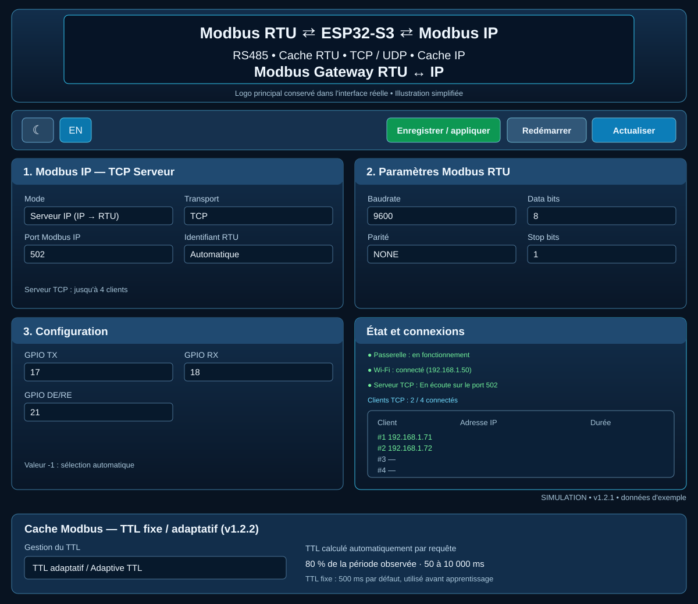
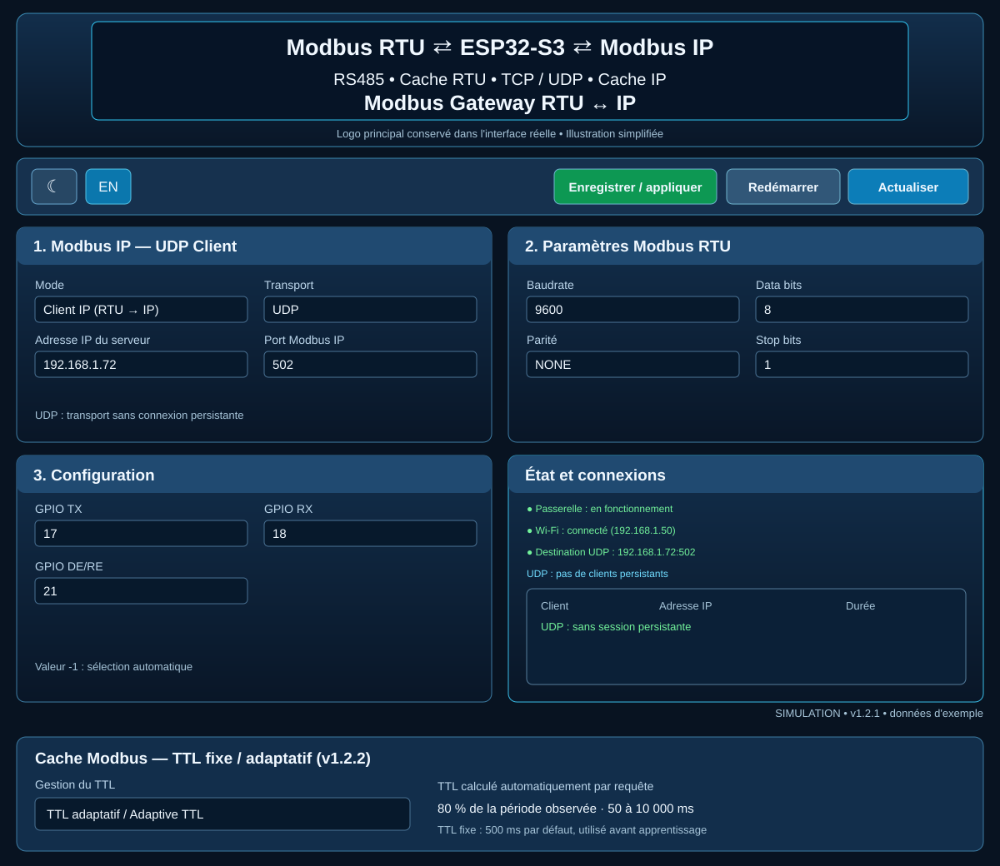
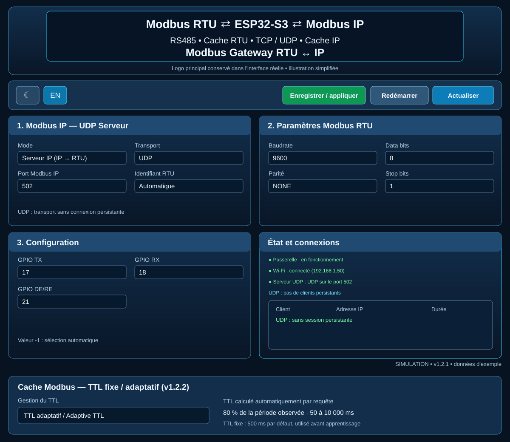

<p align="center">
  
</p>

# Modbus RTU ↔ IP (TCP/UDP) Gateway for ESPHome

[](LICENSE)

A Wi-Fi Modbus gateway built with **ESPHome**, **ESP32-S3** and the **Arduino framework**. It bridges a serial Modbus RTU / RS-485 bus and a Modbus IP (TCP/UDP) network, with a bilingual web interface for configuration and frame diagnostics.

> **Reference hardware:** [Waveshare ESP32-S3-RS485-CAN](https://docs.waveshare.com/ESP32-S3-RS485-CAN). The project defaults match this board's RS-485 signals: TX GPIO17, RX GPIO18 and RS485 enable GPIO21. The project maintainer reports successful testing with this device, including four connected Modbus TCP clients.

> **Version 1.2.3 on `main`:** supports **TCP Client, TCP Server, UDP Client and UDP Server**. The maintainer reports successful functional tests of the four modes; robustness testing remains pending. See [TCP/UDP development and UI behavior](docs/TCP_UDP_DEVELOPMENT.md).

### TCP/UDP web UI (v1.2.3)

The v1.2.3 source interface labels the network section **Modbus IP**, offers a TCP/UDP selector, and includes four harmonized blue/cyan section thumbnails matching the RTU ↔ IP header artwork. The IP thumbnail explicitly shows **TCP / UDP**. The **Persistent TCP connection** control is displayed only for **TCP Client**; it is hidden for TCP Server and both UDP modes, and the stored TCP setting is preserved while UDP is selected.

## Transport and operating modes (v1.2.3)

**Important — transport compatibility:** The Modbus IP client and its corresponding Modbus IP server **must use the same transport protocol**: **TCP Client ↔ TCP Server**, or **UDP Client ↔ UDP Server**. A TCP client cannot communicate directly with a UDP server, nor can a UDP client communicate directly with a TCP server. Using the same port number (for example, 502) does not make the two transports interchangeable.


| Transport | Client mode: RTU → IP | Server mode: IP → RTU |
|---|---|---|
| **TCP** | RTU requests forwarded over a TCP connection to the remote Modbus server | Accepts Modbus TCP requests (up to four simultaneous TCP connections) and forwards them to RS-485 |
| **UDP** | RTU requests sent as MBAP datagrams to the configured IPv4 endpoint; responses are matched to the request | Receives MBAP datagrams, queries the RS-485 bus and replies to the originating IP/port |

Choose **Transport: TCP / UDP** and **Mode: Client / Server** in Section 1 **Modbus IP**. TCP connection persistence is offered **only in TCP Client**. Client and Server read-cache switches work with either transport; the shared cache TTL mode selector is shown only when the selected mode's cache is enabled. UDP has no connection persistence and no delivery guarantee. See [Quick start](docs/QUICK_START.md), [Protocol](docs/PROTOCOL.md) and [TCP/UDP behavior](docs/TCP_UDP_DEVELOPMENT.md).

## Response cache

The gateway provides two independent optional response caches, one for each **Client/Server direction**, shared across the selected TCP or UDP transport:

- **IP Client mode (RTU → TCP/UDP):** repeated RTU read requests can be answered from the last valid Modbus TCP response.
- **IP Server mode (TCP/UDP → RTU):** repeated TCP read requests can be answered from the last valid RTU response without querying the RS-485 bus again.

Both caches are disabled by default. Each can be enabled separately in the Web UI. Choose **Fixed TTL** (50–10,000 ms; default 500 ms) or **Adaptive TTL**, which estimates a separate TTL for each polling request key from 80% of its observed request interval (bounded to 50–10,000 ms). The fixed value is used until an interval is observed. The mode is persisted in NVS; adaptive estimates remain in RAM. This feature is included in the v1.2.2 source; firmware build and hardware validation are still pending. The cache has 64 entries and only stores valid read functions 01–04. Write and read/write operations are never cached; successful writes invalidate only overlapping cached ranges in the corresponding writable data space. Unknown or malformed write ranges trigger a conservative invalidation of all cached reads for that Unit ID and direction. Cache hits do not extend the TTL. Cached values may therefore be stale up to the applicable fixed or adaptive TTL; keep the cache disabled when every read must return the freshest device value.

See [Cache behavior and configuration](docs/CACHE.md) for details. The cache option displayed in Section 1 follows the selected Client/Server mode; the other mode's setting remains saved in NVS.

## Features

- **Live cache diagnostics (current `main`):** the Counters / Diagnostics panel displays active valid cache entries (`0 / 64` when disabled) and the effective TTL range for populated entries, updated with the frame diagnostics. The occupancy reflects the selected Client/Server direction; expired entries are excluded. This addition is not yet hardware-validated.

- Per-transaction latency diagnostics in both TCP Client and TCP Server modes.
- Non-blocking TCP response reception in normal TCP Client mode: the ESPHome loop keeps servicing the Web UI and other tasks while the remote Modbus TCP server prepares its response.

- **Four transport/mode combinations** (TCP Client, TCP Server, UDP Client, UDP Server); the TCP-specific details below describe the TCP variants:
  - **TCP Client / RTU Slave:** an external RTU master polls the ESP32; the gateway forwards each request to a configured remote Modbus TCP server.
  - **TCP Server / RTU Master:** Modbus TCP masters connect to the ESP32; the gateway forwards their requests to downstream RTU slave devices.
- **Up to four concurrent TCP master connections** in TCP Server mode.
- **Single-transaction RS-485 scheduling:** the half-duplex RTU bus is accessed one transaction at a time; ready requests from connected clients are serviced with a rotating starting slot.
- TCP Transaction ID and the incoming TCP Unit ID are preserved in the response.
- **RTU address / Unit ID handling** is explicit and configurable (see [Protocol behaviour](docs/PROTOCOL.md)).
- Web interface in **French and English**.
- Settings are saved persistently in ESP32 NVS (Arduino `Preferences`). GPIO changes trigger an automatic restart so the UART can be reinitialized.
- Frame diagnostics: live RTU/TCP frame log, RTU CRC status, manual RTU-frame test and text export of the latest 64 log entries, including timing diagnostics.
- **RTU CRC protection:** invalid RTU requests/responses are rejected before forwarding or caching; CRC failures are recorded in the diagnostics log. TCP Server mode returns gateway exception `0x0B` for an invalid downstream RTU response.
- **Selectable remote-timeout policy:** one bilingual Web UI setting applies to both modes. `Standard` (default) returns a Modbus gateway exception when the remote endpoint times out; `Silent` sends no response upstream for that timeout only. The setting survives restart.
- **Mode-aware cache controls:** Section 1 shows only the cache switch for the selected TCP mode. The inactive mode's enable setting is preserved when saving or switching modes.
- Images are served on separate HTTP routes instead of being embedded in the HTML response, keeping the page response small.
- **Persistent TCP Client connection** is enabled by default to avoid a new TCP handshake for every RTU request; disable it in Section 1 when a remote server requires one connection per request. The gateway reconnects when it detects a dropped session.
- **Web UI reboot button** displays a five-second countdown and returns to the main page as soon as the gateway is online again.
- TCP diagnostics report the actual IP address from ESPHome's Wi-Fi component, rather than relying only on the Arduino `WiFi.localIP()` accessor.

## System architecture


## Web interface (v1.2.3)

### Aperçus de l'interface Web v1.2.3 — simulations

> **Illustrations simulées, et non captures réelles de l'ESP32.** Elles reprennent l'organisation actuelle (logo, barre d'actions, paramètres et tableau de connexions), avec des adresses et états d'exemple. Les vrais journaux de trames, compteurs et connexions dépendent du matériel.

**TCP Client (RTU → IP)**


**TCP Serveur (IP → RTU)**



**UDP Client (RTU → IP)**



**UDP Serveur (IP → RTU)**



Le panneau de diagnostics des trames, situé sous les paramètres, distingue **RTU RAW** (cyan), **TCP/UDP RAW** (orange) et les mesures **TIMING** (violet). La barre d'actions sous le logo regroupe le thème, la langue, **Enregistrer / appliquer**, **Redémarrer** et **Actualiser**.

## Hardware

The reference board is the **Waveshare ESP32-S3-RS485-CAN**. It provides an isolated RS-485 transceiver, an A+/B− screw terminal, Wi-Fi and USB-C. The board also has a separate CAN interface; CAN is not used by this gateway.

| Gateway signal | ESP32-S3 GPIO | Waveshare signal |
|---|---:|---|
| UART TX | 17 | RS-485 TXD1 |
| UART RX | 18 | RS-485 RXD1 |
| RS-485 direction enable | 21 | RS485_EN |

The mapping is shown in the [Waveshare board schematic](https://files.waveshare.com/wiki/ESP32-S3-RS485-CAN/ESP32-S3-RS485-CAN-Schematic.pdf) and the corresponding defaults are set in `components/modbus_gateway/__init__.py` and the web UI. The web UI allows these GPIO values to be changed for other ESP32-S3 hardware.


Connect the external RS-485 trunk to the board's **A+** and **B−** terminals. The on-board 120 Ω termination is disabled by default; enable it only when this device is at a physical end of the RS-485 line and the bus design calls for termination. See [Hardware and wiring](docs/HARDWARE_WAVESHARE.md) before powering or wiring the device.

## Quick start

1. Install ESPHome on your development computer or use the ESPHome Dashboard.
2. Copy this repository to your ESPHome configuration area.
3. Create a local `secrets.yaml` next to `my-modbus-gateway.yaml` (do not commit it). It must define `wifi_ssid`, `wifi_password` and `api_key`; see [`secrets.yaml.example`](secrets.yaml.example).
4. Review `my-modbus-gateway.yaml`. It targets `esp32-s3-devkitc1-n16r8` and uses the Arduino framework. Adjust the board target only if your exact module variant requires it.
5. Compile and upload:

   ```bash
   esphome compile my-modbus-gateway.yaml
   esphome upload my-modbus-gateway.yaml
   ```

6. Find the ESP32's IP address in your router or ESPHome logs and open `http://<ESP32-IP>/` in a browser on the same network.
7. Configure the TCP/UDP transport and Client/Server mode, network endpoint and serial settings. Press **Save / apply**. The settings are persisted; changing a GPIO restarts the ESP32 automatically.

See [Quick start and configuration](docs/QUICK_START.md) for full instructions.

## Default configuration

| Setting | Initial value |
|---|---|
| Framework | Arduino |
| ESPHome board target | `esp32-s3-devkitc1-n16r8` |
| Initial mode | TCP Client |
| TCP remote host (TCP Client mode) | 192.168.1.100 |
| TCP port | 502 |
| TCP timeout | 3 seconds |
| Remote timeout behavior | Standard (send gateway exception) |
| Persistent TCP Client connection | Enabled by default (configurable in the web UI) |
| RTU serial format | 9600 baud, 8 data bits, no parity, 1 stop bit (8N1) |
| UART TX / RX | GPIO17 / GPIO18 |
| RS-485 direction enable | GPIO21 |
| Concurrent inbound TCP clients | 4 maximum |
| Web interface | HTTP port 80 |

## Address mapping at a glance

| Mode | Data direction | RTU device address behaviour |
|---|---|---|
| TCP Client | RTU → TCP | The RTU request address is forwarded unchanged as the TCP Unit ID. The manual RTU ID setting does not override it. |
| TCP Server — Automatic ID | TCP → RTU | The incoming TCP Unit ID becomes the RTU slave address. |
| TCP Server — Manual ID | TCP → RTU | The configured RTU ID (1–247) is used on RS-485; the TCP response still carries the original incoming Unit ID. |

TCP Server accepts inbound Modbus TCP masters; UDP Server accepts MBAP datagrams from UDP clients. Up to four clients can keep their TCP sessions open at once. Their requests are not executed in parallel on RS-485: one complete RTU transaction is processed at a time.

## Documentation

- [Quick start and configuration](docs/QUICK_START.md)
- [System architecture](docs/ARCHITECTURE.md)
- [Waveshare ESP32-S3-RS485-CAN hardware and wiring](docs/HARDWARE_WAVESHARE.md)
- [Protocol behaviour, timeout policy and Unit ID mapping](docs/PROTOCOL.md)
- [Troubleshooting](docs/TROUBLESHOOTING.md)
- [Byte-level latency diagnostics](docs/LATENCY_DIAGNOSTICS.md)
- [Client TCP asynchronous handling](docs/CLIENT_TCP_ASYNC.md)
- [Response cache configuration and behavior](docs/CACHE.md)

## Security notes

- The web UI is served over plain HTTP and has no login/authentication layer in this project.
- Modbus TCP is not encrypted or authenticated by this gateway.
- Keep the ESP32 and its Modbus TCP port on a trusted LAN or isolated industrial VLAN. Do not expose ports 80 or 502 directly to the public Internet.
- Change the fallback access-point password in the YAML before deploying the device in an operational environment.
- Do not commit `secrets.yaml`, Wi-Fi credentials, API encryption keys or other credentials.

## Project status and limitations

The project maintainer reports that the current firmware works on the Waveshare ESP32-S3-RS485-CAN and that four TCP clients have been connected successfully in their test setup. The RS-485 bus remains half-duplex and is serviced sequentially. A fifth inbound TCP connection is rejected while all four slots are occupied.

The screenshots in this repository are documentation previews. Validate the firmware on the exact board, transceiver, baud rate and field bus before production use. No formal conformance certification or safety certification is claimed.

## License

This project is licensed under the **GNU General Public License v3.0 or any later
version** (`GPL-3.0-or-later`). See the [`LICENSE`](LICENSE) file for the full
license text.

Unless a file or component states otherwise, the same license applies to the
original project documentation, diagrams, screenshots, and artwork included in
this repository. Copyright in individual contributions remains with their
respective authors. Third-party software and trademarks retain their own
licenses and ownership; see [`THIRD_PARTY_NOTICES.md`](THIRD_PARTY_NOTICES.md).

The software is provided **without warranty**; see Sections 15 and 16 of the
GPLv3 license text.


## Latest release

Current source version: **v1.2.3** on `main` (fixed/adaptive cache TTL). The last release confirmed published by the maintainer is **v1.2.1**; v1.2.3 has not been published through the available GitHub integration. The v1.2.3 firmware has not yet been build- or hardware-validated. The Web UI supports mode-aware response caches, a TCP-only persistent connection setting, bilingual labels and harmonized RTU/IP artwork. See [CHANGELOG.md](CHANGELOG.md) for the release history, [docs/CLIENT_TCP_ASYNC.md](docs/CLIENT_TCP_ASYNC.md) for cooperative Client TCP handling, and [docs/CACHE.md](docs/CACHE.md) for cache behavior and data-freshness limits.
