<!-- SPDX-License-Identifier: GPL-3.0-or-later -->
<!-- Copyright (C) 2026 Modbus RTU-TCP Gateway contributors. -->

# Quick start and configuration

> **Home Assistant / ESPHome Device Builder :** une installation plus simple est disponible dans le [guide Home Assistant](INSTALL_HOME_ASSISTANT.md). Il suffit de créer un appareil ESPHome, coller le YAML du dépôt, compléter le `secrets.yaml` du Device Builder et compiler. Le composant `modbus_gateway` se télécharge automatiquement depuis GitHub ; aucun dossier `components/` à copier.

## 1. Requirements

- ESPHome with ESP32 support installed on a computer, or ESPHome Dashboard.
- An ESP32-S3 board with an RS-485 transceiver. The tested reference board for this project is Waveshare ESP32-S3-RS485-CAN.
- A 2.4 GHz Wi-Fi network reachable by the ESP32 and the selected Modbus IP (TCP or UDP) endpoint.
- A Modbus RTU device and a correctly wired RS-485 bus for end-to-end testing.

## 2. Prepare the ESPHome configuration

The repository contains:

- `my-modbus-gateway.yaml` — ESPHome node, Wi-Fi, API, OTA and component configuration.
- `components/modbus_gateway/` — the local custom ESPHome component.

Create `secrets.yaml` in the same directory as the YAML file. Use `secrets.yaml.example` as a template and replace every placeholder. Keep the real file out of Git.

The YAML also defines a fallback access point named `Modbus-Gateway-Setup` with the example password `modbus1234`. This is only a recovery path; change that password before deployment and use a trusted Wi-Fi network for normal operation.

The supplied YAML uses:

```yaml
esp32:
  board: esp32-s3-devkitc1-n16r8
  framework:
    type: arduino
```

The component uses Arduino `WiFi`, `WebServer` and `Preferences` libraries. Do not change the framework to ESP-IDF unless the component is ported and tested for it.

The sample YAML references the `main` branch of the custom component with `refresh: 0s` to obtain current changes. For **reproducible builds of the published v1.3.2 release**, replace the source ref with `github://stephdust/my-modbus-rtu-ip-gateway@v1.3.2` in the same `external_components` block. This pins the source to that release instead of following future `main` commits. See [v1.3.2 release notes](RELEASE_NOTES_v1.3.2.md).

## 3. Compile and flash

```bash
esphome compile my-modbus-gateway.yaml
esphome upload my-modbus-gateway.yaml
```

The first upload can be performed over USB. Subsequent OTA updates are available when the node is connected to Wi-Fi and the ESPHome OTA configuration is reachable.

If the board does not enter download mode, follow the board manufacturer's BOOT/RESET procedure in the [Waveshare documentation](https://docs.waveshare.com/ESP32-S3-RS485-CAN/FAQ).

## 4. Open the web interface

After the node joins Wi-Fi, find its IP address in ESPHome logs or the DHCP client list. Open:

```text
http://<ESP32-IP>/
```

The gateway's Modbus configuration and frame-diagnostics Web UI listens on TCP port **80**. The separate ESPHome diagnostics interface uses port **8080** and its stock local v3 assets; no custom script is injected. The YAML **Interface web** text sensor publishes the port-80 URL from the Wi-Fi IP address, and this can be opened directly in a browser. The Modbus TCP listener/client port is a separate setting (502 by default).

The TCP endpoint and RTU serial parameters are intentionally **not hard-coded in the YAML**. The component supplies first-boot defaults: TCP Client mode, remote host `192.168.1.100`, TCP port `502`, and RTU `9600 8N1`. These values can be changed in the web interface. Press **Save / apply** to store them in ESP32 non-volatile storage (NVS); saved values are loaded at every subsequent boot and take precedence over the component defaults.

## 5. Configure Section 1 — Modbus IP (TCP / UDP)

Select one operating mode:

### TCP Client (RTU to TCP server)

- The ESP32 receives RTU requests from the RS-485 bus.
- It forwards each request to the configured remote Modbus TCP server.
- Enter the remote server IP address and TCP port.
- The RTU slave address is retained as the TCP Unit ID.
- The RTU ID override controls are hidden in this mode.
- **Persistent TCP connection** is enabled by default. The gateway keeps the socket open between RTU requests to reduce latency and reconnects after a detected disconnect. Disable this option only if the remote server requires a new connection for every request.

### TCP Server (TCP masters to RTU)

- The ESP32 listens for inbound Modbus TCP connections on its configured port.
- Up to four TCP masters can stay connected concurrently.
- The remote host field is hidden because the ESP32 is the TCP server.
- The RTU ID selector is visible; choose Automatic or Manual.

The TCP timeout is configurable from 1 to 30 seconds; the initial value is 3 seconds.

### Modbus error response policy

The **Behavior on Modbus errors** selector applies to Client and Server modes, over TCP and UDP, and defaults to **Standard**.

- **Standard:** sends a Modbus exception when an upstream response is required but a downstream transaction fails. Timeouts and missing downstream RTU replies use gateway exception `0x0B`; other gateway-path or invalid-reply failures can use `0x0A`. Valid Modbus exception responses from the downstream device are forwarded.
- **Silent:** sends **no Modbus reply for any failure** (including timeout, connection/protocol failure, invalid downstream RTU reply or received Modbus exception). The upstream master/client relies on its own timeout. Successful responses still pass through normally.

Invalid CRC RTU requests are discarded before forwarding in either mode. The error policy is saved across restarts. See [Protocol behavior](PROTOCOL.md#remote-timeout-policy-v1113) for the current error-scope rules.

### Response cache (mode-specific)

The cache control follows the selected mode: **TCP Client** shows only the Client cache switch, while **TCP Server** shows only the Server cache switch. Switching modes changes the visible option immediately. The two settings are independent: saving one mode does not overwrite the other mode's hidden setting. When the active cache is enabled, choose **Fixed TTL** (50–10,000 ms, default 500 ms) or **Adaptive TTL**. Adaptive mode estimates each request's polling interval and sets TTL to 80% of that interval, bounded to 50–10,000 ms; the fixed value is the initial fallback. The selector is saved in NVS. The conventional cache has been exercised in user-provided gateway logs. Source v1.3.2 additionally offers an **optional TCP Client background refresh** with bounded stale data and a configurable RTU response window; the maintainer has confirmed this new behavior works well on the physical RTU display with Flow.io as the TCP server. Broader regression and endurance testing remain outstanding. Both caches are disabled by default. See [Cache behavior and configuration](CACHE.md) before enabling caching on a process where stale values could be unsafe.


### Optional v1.3.2 background cache refresh (TCP Client only)

1. Select **Transport = TCP** and **Mode = Client** in the gateway Web UI on port 80.
2. Enable **Persistent TCP connection** and **Client cache**.
3. Choose a conventional Fixed or Adaptive cache TTL; enable **Client cache: respond immediately and refresh in background**.
4. Configure **Maximum data age** (1,000–30,000 ms, default 10,000) and **RTU reply window** (250–2,000 ms, default 500).
5. Save settings and monitor `http://<GATEWAY-IP>/cache-stats` for `stale_hits`, `refresh_success`, `refresh_failure` and `late_rtu_dropped`.

The maintainer reports successful operation with a real RTU display. A stale read is **not a live value**: do not enable this option for registers that require current safety/process data. The mode remains disabled by default. See [cache behavior](CACHE.md) for details.

### Captures réelles de l'interface Web v1.2.7 — quatre modes

Ces **16 captures réelles** proviennent de l'interface ESP32-S3 en version **1.2.7**, et remplacent les anciennes captures v1.2.6 et les simulations SVG. Les valeurs (IP, états, trames, compteurs) sont des exemples observés, pas des résultats de validation exhaustive. Les modes **Client / Serveur** sont indépendants du transport **TCP / UDP**.

#### TCP Client — RTU vers serveur TCP

Connexion TCP persistante optionnelle, cache Client et TTL adaptatif, connexions et journal des erreurs TCP.

**1. Configuration Modbus IP et bandeau**

<a href="assets/v1.2.7-tcp-client-01.png">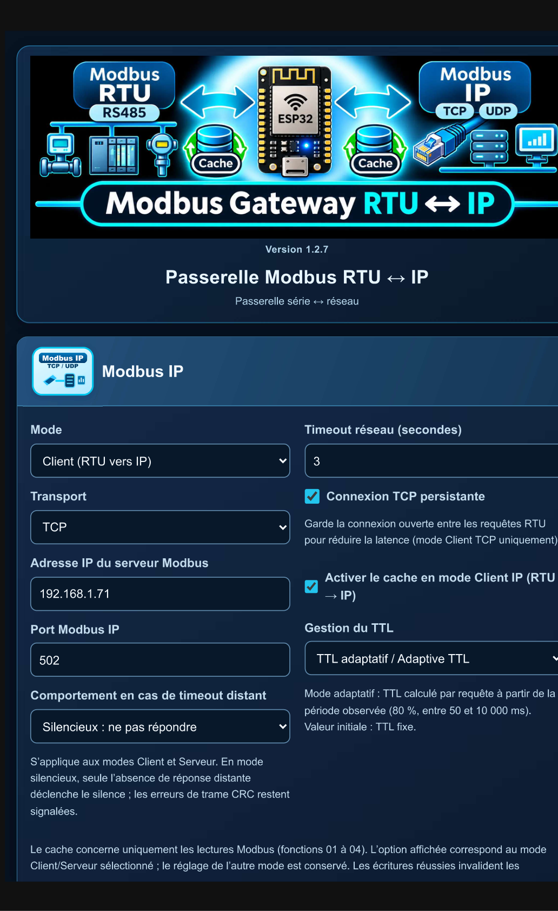</a>

**2. Paramètres RTU, GPIO et état des connexions**

<a href="assets/v1.2.7-tcp-client-02.png">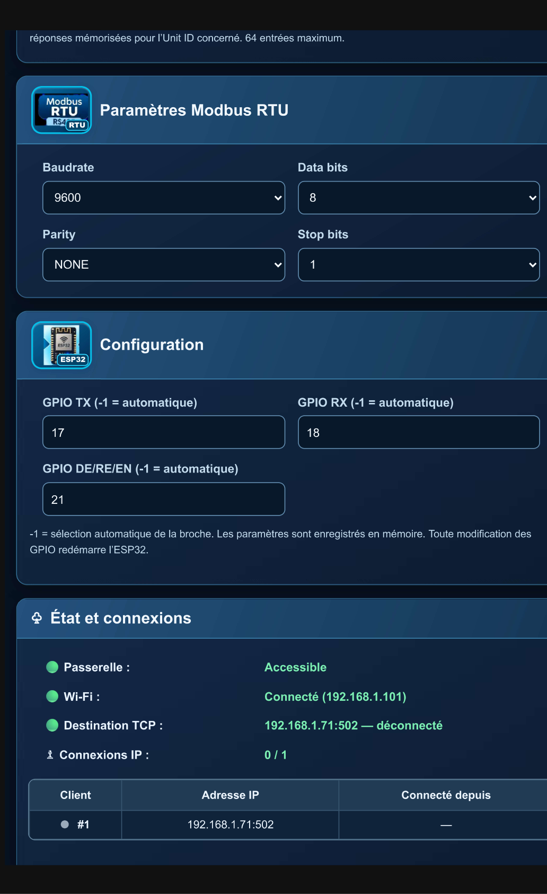</a>

**3. Compteurs / Diagnostics et envoi manuel**

<a href="assets/v1.2.7-tcp-client-03.png">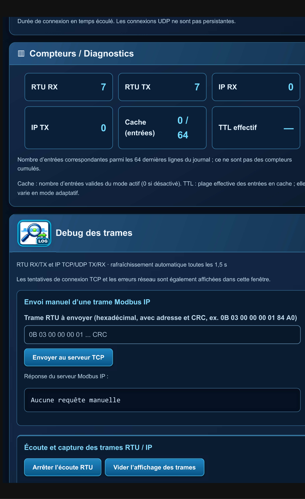</a>

**4. Écoute des trames, journal et commandes**

<a href="assets/v1.2.7-tcp-client-04.png">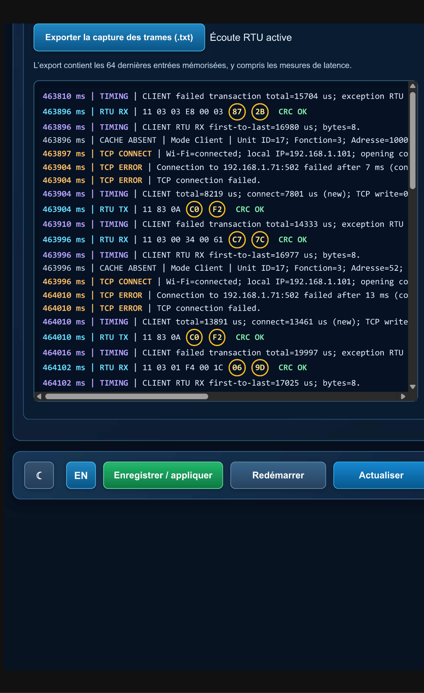</a>

#### TCP Serveur — clients TCP vers RTU

Port d'écoute 502, clients TCP (jusqu'à quatre affichés), paramètres RTU et diagnostics.

**1. Configuration Modbus IP et bandeau**

<a href="assets/v1.2.7-tcp-serveur-01.png">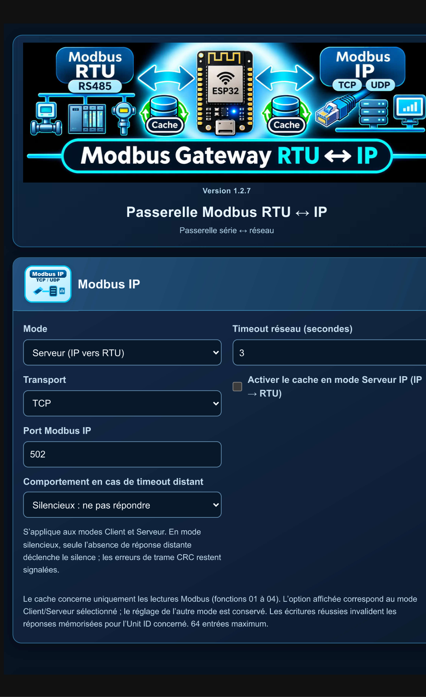</a>

**2. Paramètres RTU, GPIO et état des connexions**

<a href="assets/v1.2.7-tcp-serveur-02.png">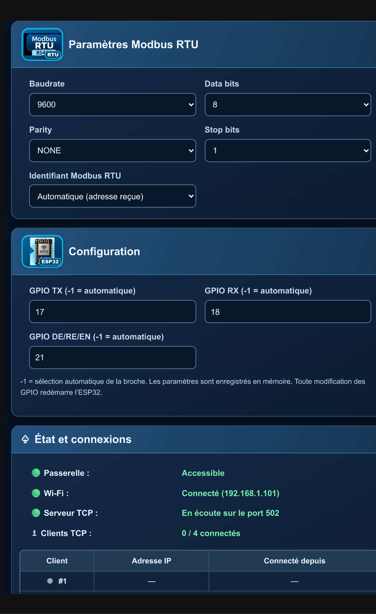</a>

**3. Compteurs / Diagnostics et envoi manuel**

<a href="assets/v1.2.7-tcp-serveur-03.png">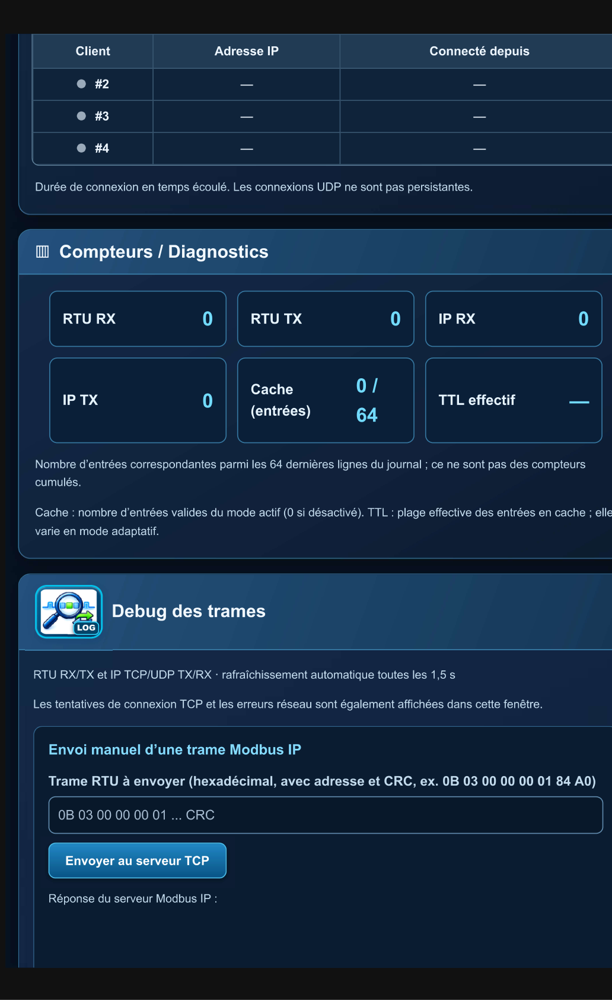</a>

**4. Écoute des trames, journal et commandes**

<a href="assets/v1.2.7-tcp-serveur-04.png">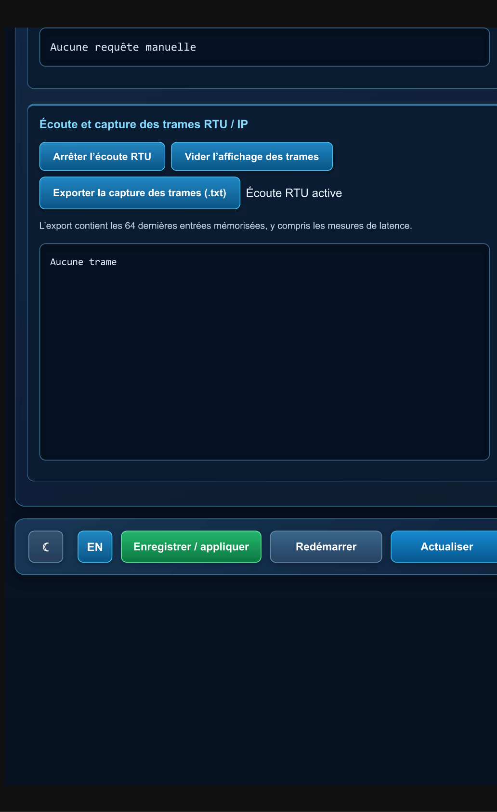</a>

#### UDP Client — RTU vers serveur UDP

Destination UDP, cache Client adaptatif, compteur IP TX et journal des timeouts UDP.

**1. Configuration Modbus IP et bandeau**

<a href="assets/v1.2.7-udp-client-01.png">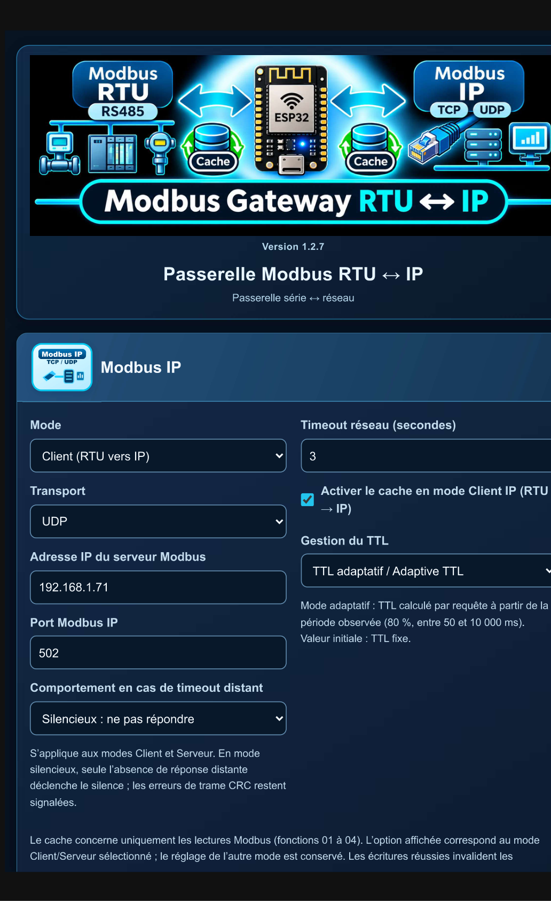</a>

**2. Paramètres RTU, GPIO et état des connexions**

<a href="assets/v1.2.7-udp-client-02.png">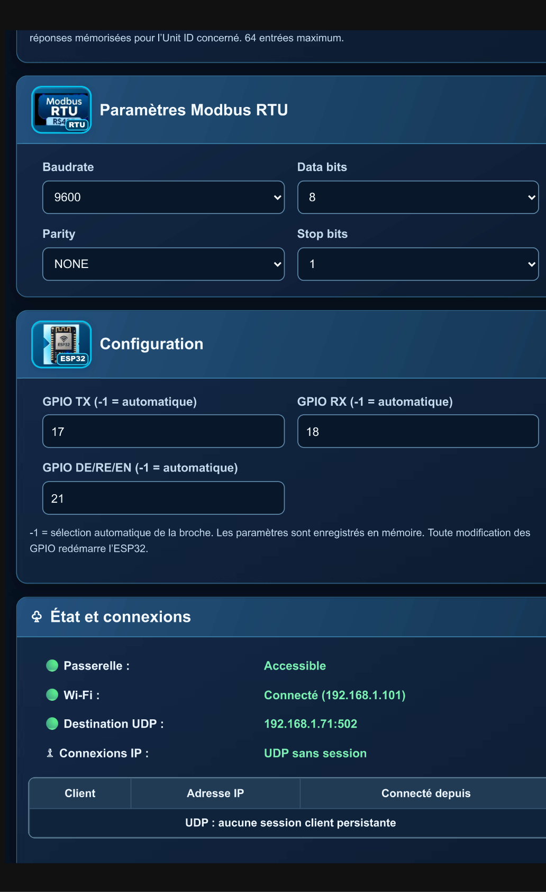</a>

**3. Compteurs / Diagnostics et envoi manuel**

<a href="assets/v1.2.7-udp-client-03.png"></a>

**4. Écoute des trames, journal et commandes**

<a href="assets/v1.2.7-udp-client-04.png">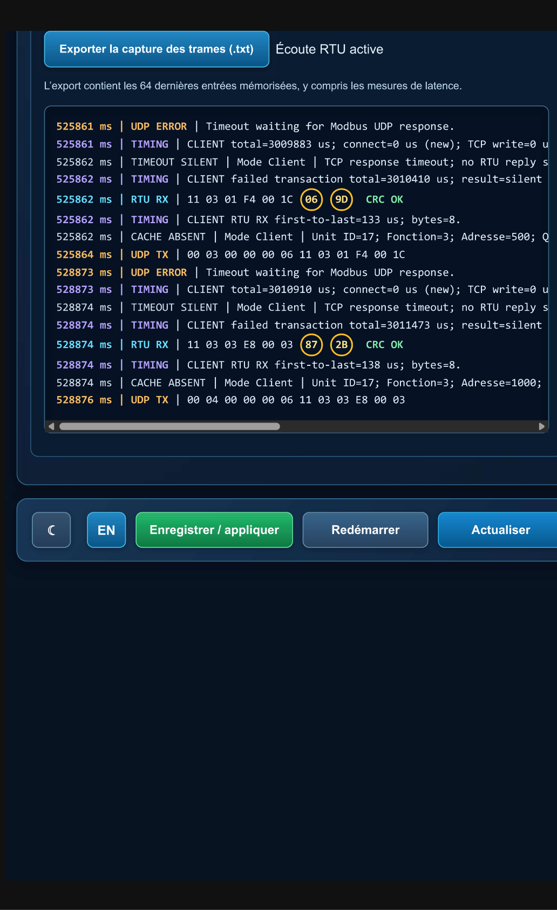</a>

#### UDP Serveur — requêtes UDP vers RTU

Port UDP local 502, absence de session persistante, configuration RTU et journal de capture.

**1. Configuration Modbus IP et bandeau**

<a href="assets/v1.2.7-udp-serveur-01.png"></a>

**2. Paramètres RTU, GPIO et état des connexions**

<a href="assets/v1.2.7-udp-serveur-02.png">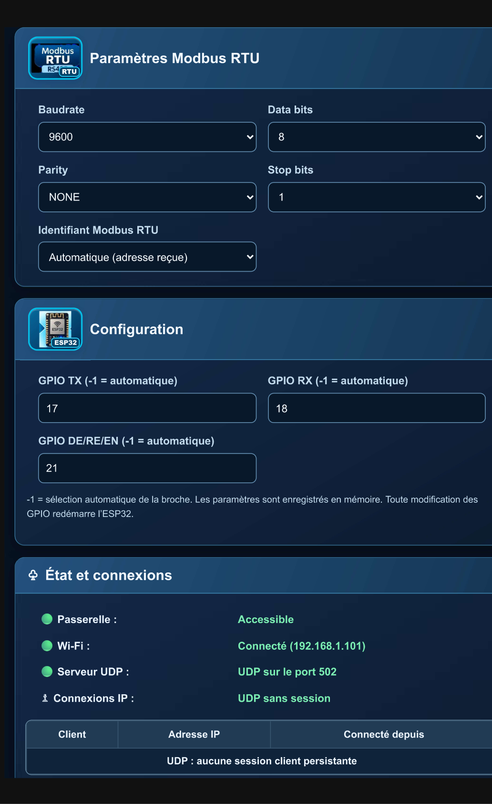</a>

**3. Compteurs / Diagnostics et envoi manuel**

<a href="assets/v1.2.7-udp-serveur-03.png">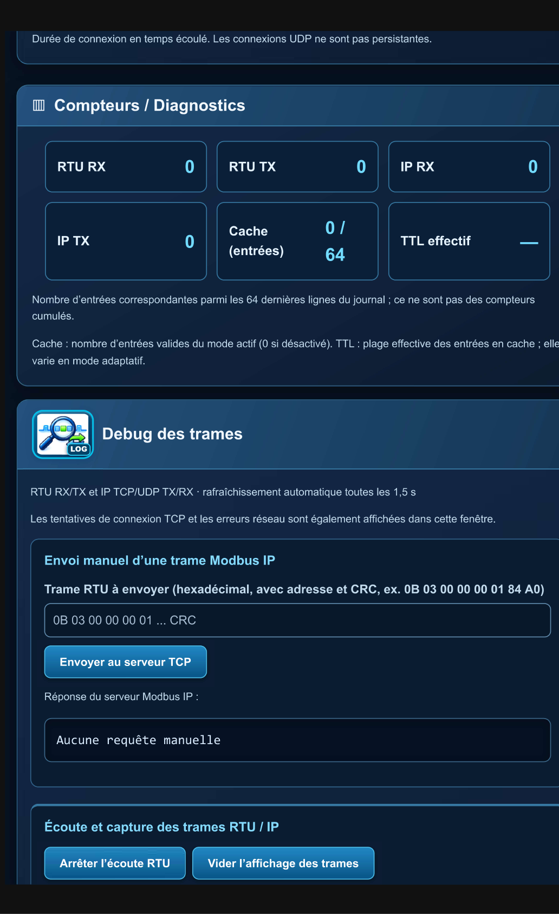</a>

**4. Écoute des trames, journal et commandes**

<a href="assets/v1.2.7-udp-serveur-04.png">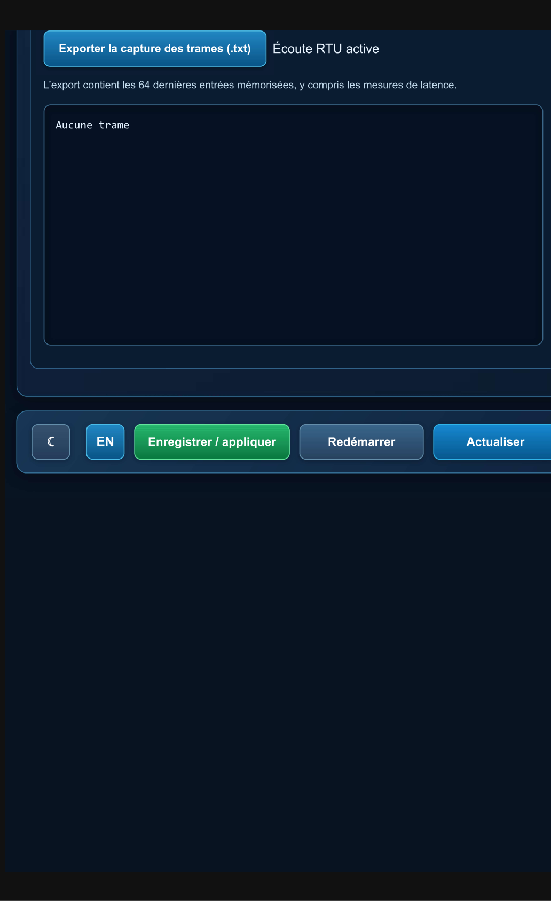</a>

**Remarque :** sur certaines captures UDP, le bouton d'envoi manuel indique encore « Envoyer au serveur TCP » et les descriptions du journal mentionnent TCP. Ces libellés sont ceux de l'interface photographiée et seront à corriger séparément dans le firmware.

## 6. Configure Section 2 — Modbus RTU

Set the serial parameters to match the RTU devices on the RS-485 segment:

- Baud rate: 1200, 2400, 4800, 9600, 19200, 38400, 57600 or 115200.
- Data bits: 7 or 8.
- Parity: None, Even or Odd.
- Stop bits: 1 or 2.

The initial serial format is **9600, 8 data bits, no parity, 1 stop bit (9600 8N1)**.

In TCP Server mode, select:

- **Automatic:** use the TCP request's Unit ID as the RTU address.
- **Manual:** use the configured RTU ID (1–247) for the RTU request, regardless of the Unit ID in the inbound TCP request. The TCP response retains the request's original Unit ID.

## 7. Configure Section 3 — GPIO

For the Waveshare ESP32-S3-RS485-CAN reference board, the project defaults are:

| Signal | GPIO |
|---|---:|
| UART TX | 17 |
| UART RX | 18 |
| RS-485 direction enable | 21 |

`-1` selects the component's automatic/default pin handling for that field. Use the exact pinout of your target board before changing GPIO values. Applying a GPIO change restarts the ESP32 so the UART and direction control can be initialized again.

## 8. Save all settings

The **Save / apply** button below Sections 1–3 saves all network, RTU, TCP persistence and GPIO settings together. Settings are stored persistently in ESP32 NVS using Arduino Preferences and are loaded again at boot.

The **Restart gateway** button reboots the ESP32 without changing saved settings. It uses a five-second countdown page and automatically returns to the main Web UI when the gateway responds again. If a GPIO value changed, saving the configuration also triggers this restart flow automatically.

## 9. Use Section 4 — Frame diagnostics

The diagnostics page provides:

- RTU listening pause/resume control in TCP Client mode.
- A manually entered RTU frame test (hexadecimal bytes including RTU address and CRC).
- A display of the response to the manual test.
- A live rolling log of RTU RX/TX and TCP RX/TX events.
- `TIMING` entries with per-stage durations in microseconds. In TCP Client mode these report connection/reuse, TCP write, TCP response wait and end-to-end RTU response transmission. In TCP Server mode they report client queue wait, RS-485 transmit time, RTU response wait, TCP response write and total gateway processing time.
- RTU CRC validation indicators in the browser.
- **Export frame capture (.txt)**, which downloads `modbus-frame-capture.txt` with up to the 64 most recent logged entries, including timing diagnostics.

Frame timestamps are milliseconds since ESP32 boot; they are not wall-clock timestamps.

## 10. Verify the installation

1. Confirm the ESP32 is connected to Wi-Fi.
2. Open the web page and verify the saved mode and serial settings.
3. Confirm that the RS-485 bus A+/B− wiring and termination are correct.
4. Test one known RTU slave before connecting multiple TCP masters.
5. In TCP Server mode, connect up to four independent Modbus TCP clients and check that each receives its own response.
6. Review the frame log and export it if you need a troubleshooting record.

## 11. CRC and latency diagnostics

Invalid RTU CRC frames are discarded before forwarding or cache storage. The Web trace reports `CRC ERROR` with the received and calculated CRC. In TCP Server mode, an invalid RTU response is not forwarded as data; the TCP requester receives gateway exception `0x0B`. Incomplete RTU responses and timeouts are logged as `RTU ERROR`. If Silent mode is selected, errors are logged (for example, as `ERROR SILENT`) and no upstream Modbus error response is sent.

The diagnostics also report per-stage timing and receive-byte observations. These are software timestamps from the ESP32, not oscilloscope measurements. See [Latency diagnostics](LATENCY_DIAGNOSTICS.md).


## TCP / UDP configuration (v1.2.7)

**Required compatibility check:** Configure the gateway's IP transport to match the remote Modbus IP endpoint: **TCP Client ↔ TCP Server** or **UDP Client ↔ UDP Server**. TCP and UDP are different transport protocols, even when both endpoints use port **502**. A TCP client cannot exchange Modbus requests with a UDP-only server, and vice versa. For the gateway's **IP Server** mode, the external IP client must likewise select the matching TCP or UDP transport.


In Section **1. Modbus IP**, choose **Transport = TCP** or **UDP** and **Mode = Client** or **Server**. All four combinations are supported:

| Selection | Gateway behavior |
|---|---|
| TCP Client | Receives RTU requests and forwards them to a remote Modbus TCP server |
| TCP Server | Receives Modbus TCP requests and forwards them to downstream RS-485 slaves |
| UDP Client | Receives RTU requests and forwards them as MBAP datagrams to a configured IPv4 UDP endpoint |
| UDP Server | Receives Modbus MBAP datagrams and forwards requests to downstream RS-485 slaves |

The network host, port and timeout settings apply to the selected transport. UDP Client requires a numeric IPv4 destination. UDP does not establish or maintain a connection and does not guarantee delivery. **Persistent TCP connection** appears only in **TCP Client**; it is hidden in TCP Server and both UDP modes. Its saved value is retained when switching away from TCP.

The **Client** and **Server** cache checkboxes follow the selected mode, regardless of transport. The **TTL mode** selector appears only if the selected mode's cache is enabled. **Fixed TTL** shows the numeric TTL (ms) input; **Adaptive TTL** hides that numeric input while preserving its value as a fallback. Disabling the cache hides both controls without erasing saved settings. See [Cache behavior](CACHE.md) and [UDP development details](TCP_UDP_DEVELOPMENT.md).

The earlier TCP-specific examples and screenshots in this guide remain valid for TCP, but should not be interpreted as excluding UDP.


> **Historical gallery:** The screenshots above document the v1.2.7 interface and may not show controls introduced in newer source versions, including the optional v1.3.2 background cache refresh.
